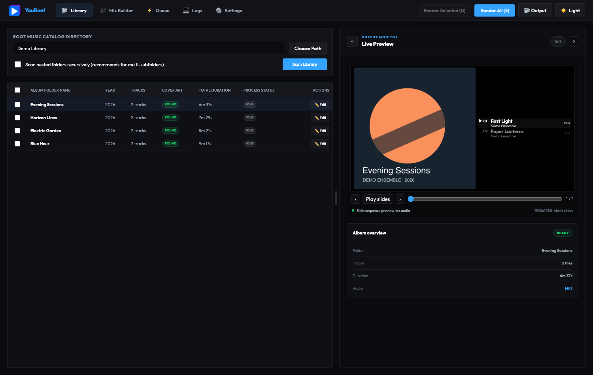
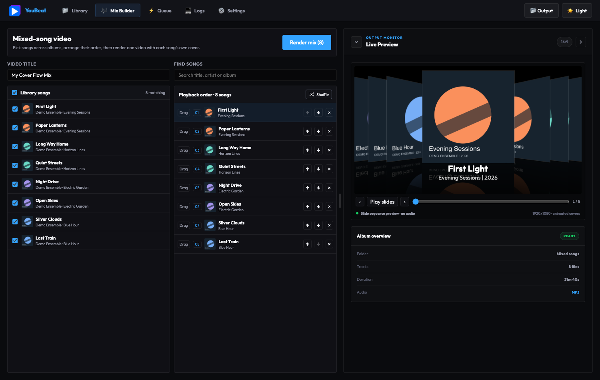

# YouBeat

Turn music albums and hand-picked mixes into cover-art videos for YouTube, with a live layout preview, local batch rendering and bundled FFmpeg.

[Download Mac & Windows apps](https://github.com/BASF2HD/YouBeat/releases/latest) · [Download website](https://basf2hd.github.io/YouBeat/) · [Release notes](RELEASE-NOTES.md)

## Screenshots

These show the actual app UI with synthetic demo albums and artwork, not a personal music library.





## Install and start

| Computer | Package | Use |
| --- | --- | --- |
| Apple Silicon Mac, macOS 12+ | `.dmg` or Mac `.zip` | Install from the DMG, or unzip and open the `.app` to test without installation. |
| Intel Mac, macOS 12+ | `mac-x64.dmg` or `mac-x64.zip` | Choose the Intel build for a Mac with an Intel processor. |
| Windows x64 | `Setup.exe` | Install with a selectable destination. |
| Windows x64 | `Portable.exe` | Run without installing. |

Standalone downloads include Electron and FFmpeg. You do **not** need Node.js, npm or a separate FFmpeg installation. Separate native Mac packages are available for Apple Silicon (`arm64`) and Intel (`x64`).

Builds are unsigned and not Apple-notarized. Verify the version, source and release `SHA256SUMS` before opening; do not disable system security globally. The GitHub Pages website offers information/downloads, not browser-based rendering.

## Render your first album

1. Choose your source music folder in **Library**. Enable recursive scanning if albums live in subfolders, then **Scan Library**.
2. Click an album to inspect its tracks and live preview. Use table checkboxes to select albums, including the header checkbox for all.
3. In **Settings**, choose an output folder, artwork theme, resolution, fonts and audio/video profile. The app checks that the output location can actually be written to.
4. Use **Render selected** or the full-library render action. The queue shows progress and errors; pause/resume/cancel controls are available.
5. Open a completed video from its queue-row icon or the output folder. Upload manually in YouTube Studio.

Source music is read, not retagged or deleted. Metadata adjustments in YouBeat are local overrides. Use Tag Maestro if you want to change original song tags or embedded artwork.

## Library scanning and queue

- Recognizes `.mp3`, `.flac`, `.wav`, `.m4a` and `.aac` audio files.
- Reads track number, title, artist, album, year, duration and artwork from metadata, with filename fallbacks for missing tags.
- Each scan discovers folders again, so newly added albums appear. Unchanged cached metadata is reused rather than replacing discovery with an old album list.
- Table multi-selection enables selected-album rendering. The queue runs albums serially, reports failed items and supports opening successful outputs.
- Terminal logs support text selection and copying for troubleshooting. Errors are not a reason to blindly pick another output folder: check the actual message first.
- **Fast Resume / skip existing** can avoid re-rendering completed exports. Turn it off, or use a different output folder, when changing the theme or typography of an already-exported album.

Large/NAS libraries still require directory discovery and some metadata reads. Start with a small local test album, then check share permissions and network stability. Choose the right parent folder and recursive setting if new albums do not appear.

## Artwork themes and live preview

| Theme | Presentation | Default typography at 1080p |
| --- | --- | --- |
| Classic cover | Proportional artwork beside an active-track list | Song title 40 px; artist 30 px |
| CD jewel case | Same track-list layout with a jewel-case overlay | Song title 40 px; artist 30 px |
| Cover Flow | Centre sleeve, angled side sleeves, reflections and slide transitions; no song list | Song title 72 px; album/year 48 px |

Settings provide saved font-size controls, font family, colors, resolution and song-row gap. Classic/CD Jewel place the play marker before the song number on the title line. The album-summary header is omitted to leave more space for artwork and readable tracks.

Classic/CD Jewel cover height is adjustable from 50–100%, independently for each theme. Defaults are 100% Classic and 75% CD Jewel. The song list moves with the cover edge; artwork keeps its proportions. The default row gap is 8 px, adjustable from 0–40 px. Longer lists use an active-song-following window instead of making all text tiny or hiding artists.

Cover Flow captions are constrained to the centre sleeve width, with ellipsis for long song/album names. Reflections use opaque floor planes to prevent other covers bleeding through. Typography and layout scale for 720p and the preview.

Resize the preview pane with its divider handle. **Previous**, **Next**, the song-position slider and **Play slides** let you inspect song-to-song visual transitions before exporting. This is a slide/layout preview, not an audio-quality listening test.

The jewel-case overlay ships from `resources/cd-jewel-case-overlay.png`. Replacing a source asset does not update an already-built standalone application: rebuild and relaunch that package to include the new file.

For optional back artwork, open an album's **Edit** dialog, choose its **Back cover**, and **Save overrides**. You can also change the front cover there. Use **Crop / fit to square** to adjust the back: **Crop to fill square** offers zoom and position controls; **Fit whole image** keeps the entire image with black padding. Choose **Use square artwork**, then **Save overrides**. Selected and cropped images are saved as separate copies inside YouBeat's profile, leaving source files unchanged. Replacing an image, even with the same filename, refreshes its preview.

With the **CD jewel case** theme, each song turns the case from right to left over one second, shows the back for five seconds, then turns back to the front over one second in both Live Preview and exported video. Short songs shorten the turns and hold to fit. Albums without a back cover keep showing the front. Artwork choices persist across scans and restarts. Remove a back cover in the same dialog to disable its flip. Turn off **Fast Resume / skip existing** when replacing an already rendered video.

## Mix Builder

Select songs from different scanned albums using individual or select-all checkboxes. Each song retains its own artwork and album/year information. Give the mix a title, reorder songs with drag-and-drop or arrow buttons, and use **Shuffle** for a random order.

Preview the ordered mix, choose its presentation in Settings, and render it as one video. Cover Flow is suited to mixes with different album covers, while the other themes provide a track-list view.

## Files produced

Exports use the album name and year: `Album Name (Year).mp4`, without theme IDs, font settings or audio-profile text added to the name.

- H.264 MP4 video with the selected audio profile.
- A description text file with cumulative song timestamps for YouTube descriptions/chapters.
- A JPEG thumbnail from the slide layout.

Upload videos yourself in YouTube Studio and paste the timestamp text into the description, checking YouTube's chapter requirements. Chapters are not created merely by embedding song titles in the MP4. There is no built-in YouTube upload, password storage, OAuth connection or Google Cloud account requirement.

## Audio quality: important limits

The default upload profile is **AAC-LC, 48 kHz, 384 kb/s stereo**, with 128 kb/s mono and 512 kb/s surround profiles. This is a high-bitrate **lossy local encode**, not YouTube's own server encoder and not bit-perfect preservation. YouTube re-encodes uploads; no local setting can prevent that or restore detail missing from the original audio.

An optional **ALAC** profile offers lossless local audio encoding. When sources differ, segments are converted to a shared sample rate/channel format so they can be joined; lossless encoding after conversion does not mean the original samples were unchanged. Keep original music files for archival preservation. ALAC exports are larger and YouTube still processes their audio.

For your usual manual YouTube upload, the AAC default keeps file size practical while avoiding unnecessarily low bitrates. No separate audio-quality downgrade is performed on your source music files.

## Rendering performance

- Still-image portions are encoded at approximately one frame per second with inter-frame compression, rather than repeatedly encoding identical high-frame-rate frames. Cover Flow transitions use their animation frames.
- Segments share a compatible stream format and are joined without another full video encode.
- **Auto** attempts an available hardware encoder: Apple VideoToolbox on Mac; Intel Quick Sync, NVIDIA NVENC or AMD AMF on Windows. It falls back to software H.264 if hardware initialization is unavailable.
- GPU availability depends on the bundled FFmpeg build, drivers and codec support, not simply the GPU brand. Slide capture, audio conversion, file reads and muxing still use CPU/disk resources.
- Temporary render files are cleaned after completion/cancellation. Keep adequate free space during large jobs.

If a laptop becomes hot, check the selected encoder and logs, reduce simultaneous work outside the app, and compare a small test album. A powerful GPU cannot accelerate every part of the pipeline.

## Troubleshooting

| Symptom | What to check |
| --- | --- |
| New albums missing | Correct source location, supported audio extensions, recursive setting, and scan errors; scan again to rediscover folders. |
| Output cannot be written | Choose an existing writable folder, run the output check, and inspect permissions/NAS connection. Dependency or FFmpeg errors are not folder errors. |
| Missing FFmpeg | Use a current standalone release, or run the source setup/build scripts. Packages already include the executable. |
| Old theme/artwork still in export | Disable skip-existing/Fast Resume and render again. Rebuild a standalone app after changing packaged assets. |
| Very large MP4 | Check ALAC vs AAC, resolution and quality; lossless audio can dominate size on long albums. |
| Track list looks cramped | Adjust title/artist sizes, cover height and row gap. Long lists follow the current song. |
| Hardware encode fails | Use Auto or software H.264; inspect logs and drivers. |

## Develop and build from source

Use Node.js 24 with npm. The lockfile fixes dependency versions:

```sh
git clone https://github.com/BASF2HD/YouBeat.git
cd YouBeat
npm ci
npm start
```

`npm start` builds and launches the desktop app, installing missing dependencies when needed. FFmpeg provisioning requires an initial download for the target platform. Source development needs development tools; the standalone downloads do not.

```sh
npm run dev           # Vite frontend development server
# In a second terminal:
VITE_DEV_SERVER=true npm run electron:dev

npm run build
npm run pack          # unpacked app for the current computer
npm run dist:mac      # native macOS arm64 DMG + app ZIP
npm run dist:mac:intel # native Intel macOS x64 DMG + app ZIP
npm run dist:win      # native Windows x64 Setup + Portable EXE
node scripts/verify-scan-discovery.cjs
node scripts/test-packaged.mjs "path/to/packaged/executable"
node scripts/check-publication-privacy.mjs
```

Build on the intended OS/architecture with a fresh dependency installation. The package hook rejects mismatched/nonfree FFmpeg binaries instead of shipping an unusable cross-build. GitHub releases require native Mac and Windows packaged tests using temporary synthetic media and isolated profiles; tests exercise output checks, metadata, the jewel overlay, queue rendering and decoding a short MP4.

## Architecture, privacy and licensing

`src/main/` handles scanning, metadata, FFmpeg and the queue; `src/renderer/` contains the React interface; `src/shared/` holds the common artwork/track layout and types. Electron captures slide frames offscreen. The app is **desktop-only**: a browser-only version would require a different local media pipeline or rendering backend.

Settings and metadata overrides are stored locally. Existing profiles from the former app name are migrated once, retaining the original profile. There is no automatic upload of music to YouTube or an AI service.

Project code is MIT-licensed; bundled third-party components retain their licenses. FFmpeg is provisioned as a checksum-pinned GPL build with licenses and provenance beside the executable. Mac releases use dfloresc/ffmpeg-macos-builds v9.0.1-1 and include corresponding component source archives in the release. Windows uses the checksum-verified Gyan GPL build from ffmpeg-static 5.3.0. Keep these notices and source access when redistributing packages.

[Project license](LICENSE) · [Publication privacy policy](PUBLISHING.md)
